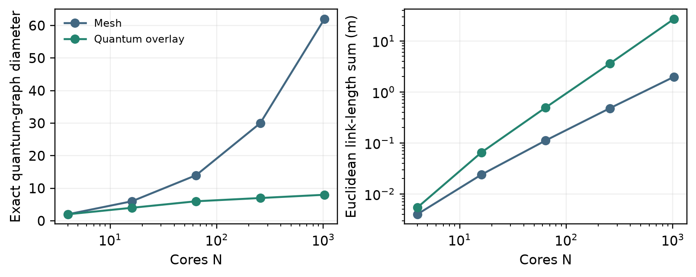

# DEQUINT

**Reproducible, resource-aware experiments for decentralised quantum interconnects.**


DEQUINT studies how entanglement provisioning, rendezvous routing, memory aging,
finite resources and classical control affect **completed, quality-qualified
inter-core CNOT tasks**. This repository contains the executable research addon,
regression tests, raw experiment records, analysis tools and historical code
snapshots. It is not a physical quantum-processor implementation.

**Start here:** [Reproduce](docs/GETTING_STARTED.md) ·
[Reviewer guide](docs/REVIEWER_GUIDE.md) · [Architecture](docs/ARCHITECTURE.md) ·
[Experiments and results](docs/RESULTS.md) · [Publication boundary](docs/PUBLICATION_SCOPE.md)

## What Is Included

| Area | Contents |
| --- | --- |
| Resource-aware network | Native SeQUeNCe event scheduling; finite memories, retries, admission, deadlines and cleanup |
| Quantum-state models | Bell-diagonal/Pauli noise, conditional BBPSSW, memory dephasing and correlated CNOT process fidelity |
| Native photonic backend | Separate Barrett-Kok, teleportation and routed-CNOT Choi-channel checks |
| Classical control | Contended directed wired links and shared token-radio service |
| Application replay | Dependency-preserving circuit-DAG timing and logical-to-core placement |
| Quantum shortcuts | Mesh plus bounded-degree quantum overlay, with link, cable and loss accounting |
| Compiled controls | Restored-CNOT teleportation skeletons versus matched SABRE routing |
| Evidence | Raw requests, event traces, workloads, configurations, QASM, Choi matrices and paired analyses |
| History | Recovered early prototypes, isolated arithmetic checks and seven addon source checkpoints |

## Quick Start

Python **3.12** and Git are required. Use a fresh virtual environment.

```bash
git clone https://github.com/sourodeepkundu2025-hub/dequint-research.git
cd dequint-research
python -m venv .venv
```

Activate the environment (`source .venv/bin/activate` on Linux/macOS, or
`.venv\Scripts\Activate.ps1` in PowerShell), then:

```bash
python -m pip install -e ".[test]"
git clone --branch v1.3.0 https://github.com/sequence-toolbox/SeQUeNCe.git SeQUeNCe
git -C SeQUeNCe checkout --detach 88f92cca8aaa6dbf82bccc6a759465120afbdd34
python tools/verify_public_release.py
python -B -m pytest tests -p no:cacheprovider
```

The upstream checkout is used to verify native-source provenance. The addon does
not modify upstream SeQUeNCe. Do not run the files under `history/` as the current
implementation. Full setup, isolated reruns and output-protection rules are in
[Getting Started](docs/GETTING_STARTED.md).

A small API example is available at
[`examples/minimal_network.py`](examples/minimal_network.py):

```bash
python examples/minimal_network.py
```

## Experiment Map

| Evidence family | Retained scope | Location |
| --- | --- | --- |
| Primary abstract network | 460 runs; 22,080 offered CNOT tasks | [`batch_v2`](results/batch_v2/) |
| Native/application/control follow-up | 300 runs; distinct backend profiles | [`followup_v1`](results/followup_v1/) |
| Quantum-overlay probe | 432 runs; 13,824 offered endpoint-CNOT tasks | [`shortcut_v1`](results/shortcut_v1/) |
| Matched wired/radio sensitivity | 48 runs; 1,152 offered CNOT tasks | [`review_supplement_v1`](results/review_supplement_v1/) |
| Ideal compiled channels | 18 restored-CNOT channels and 108 schedules | [`compiled_depth_v1`](results/compiled_depth_v1/) |
| Exact primitive validation | 472 checks | [`quantum_validation`](results/quantum_validation/) |
| Separate native references | 32 trials per reference protocol | [`native_reference`](results/native_reference/) |

These profiles answer different questions. Their counts and rates must **not** be
pooled as one physical experiment. `batch_v1` is retained only as a quarantined,
pre-review artifact and is **not accepted evidence**.

### Example: Connectivity Has a Cost



The overlay reduces graph-hop diameter, but adds optical links and cable length.
The figure is a model-based topology result, not a measured processor latency or
a physical-layout validation. [Read the exact protocol](docs/SHORTCUT_EXTENSION_PROTOCOL.md).

## Findings and Boundaries

- The quantum overlay has an explicit logarithmic **hop** construction. Expected
  latency needs additional bounded-service/waiting assumptions; the original mesh
  does not gain logarithmic quantum paths from classical radio shortcuts.
- The tested quality term has **no established added benefit** over queue-only
  routing in the primary comparison; its paired interval includes zero.
- Radio is slightly slower in all eight matched transport contrasts. There is no
  measured universal WiNoC gain or crossover in those cells.
- Matched SABRE controls are shallower and use fewer CX gates than the tested
  ideal teleportation skeletons. Application/QEC depth gains are not established.
- No FPGA/ASIC, physical QPU, cryogenic prototype, thermal/EMI compatibility or
  relevant-environment hardware validation is supplied.

See [Results](docs/RESULTS.md), the
[claim-to-implementation map](docs/CLAIM_IMPLEMENTATION_MAP.md) and the
[backend ledger](qa/QUANTUM_BACKEND_LEDGER.csv) before interpreting a result.

## Repository Layout

```text
src/dequint/                 Current scientific implementation
tests/                      Current regression and integration tests
tools/                      Experiment, analysis and reporting utilities
docs/                       Setup, architecture, protocols and interpretation
results/                    Frozen raw data, analyses, circuits and figures
qa/                         Scientific evidence and lineage ledgers
inputs/legacy_prototypes/    Recovered early standalone code
history/                    Earlier checks and addon source snapshots
PUBLICATION_PROVENANCE.json  Original/public identity for each collected file
PUBLIC_SHA256SUMS.json       Verifiable identity of the public snapshot
```

## Citation, Contributions and Rights

Use the repository's **Cite this repository** entry or [CITATION.cff](CITATION.cff),
and cite the exact commit for reproducibility. This is a research software
artifact, not a claim of journal acceptance or a new quantum protocol.

Read [CONTRIBUTING.md](CONTRIBUTING.md), [SECURITY.md](SECURITY.md),
[RIGHTS.md](RIGHTS.md) and [THIRD_PARTY_NOTICES.md](THIRD_PARTY_NOTICES.md).
Public visibility does not grant a new repository-wide reuse license.
Confidential review correspondence, patent disclosures, private source archives
and third-party paper/template assets are intentionally not published.
