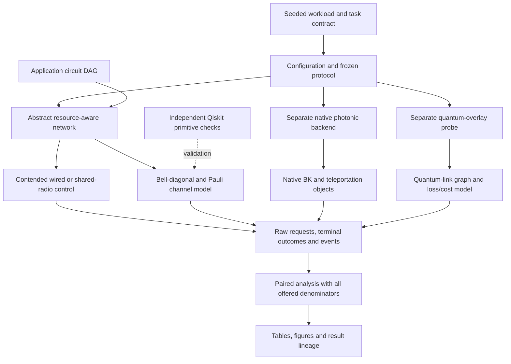

# Architecture and Code Map

## Execution Flow

The arrows do not imply that all backends use the same optical or noise model.
Each backend's protocol and limitations remain separate.

## Module Responsibilities

| Module | Responsibility | Key boundary |
| --- | --- | --- |
| `config.py` | Validated model parameters and prospective profiles | Configuration, not device calibration |
| `kernel.py` | Coroutine/capacity adapter on native Timeline/Event/Process | Native scheduling is not native optical simulation |
| `workload.py` | Seeded requests and matched workload identities | Preserve arrivals, endpoints and denominators |
| `routing.py` | Endpoint, balanced meeting, queue and quality-aware decisions | Critical path differs from total resource cost |
| `network.py` | Preparation, retries, finite memories, ownership, gates and deadlines | Never retry an unknown payload after destructive measurement |
| `transport.py` | FIFO wired links and shared radio with token/service contention | Classical messages never carry unknown amplitudes |
| `quantum.py` | Conditional Pauli quality, BBPSSW and correlated two-qubit channels | Availability probability is not conditional fidelity |
| `quantum_validation.py` | Independent density-matrix/circuit agreement checks | Primitive validation, not physical network validation |
| `native_reference.py` | Pinned upstream protocol reference checks | Separate bounded protocol experiments |
| `native_mesh.py` | Native photonic routed-CNOT backend and Choi diagnostics | Native generation uses dedicated fixed-delay sidebands |
| `application_replay.py` | Circuit-DAG timing and placement/failure propagation | No complete application state fidelity or physical depth |
| `shortcut_probe.py` | Added quantum links, finite ports and global generation | Abstract optics; installed links/cabling are unequal |
| `compiled_depth.py` | Ideal restored-CNOT skeletons and matched routing controls | No optical retries, physical timing or QEC-depth claim |
| `experiments.py`, `followup.py`, `analyze.py` | Frozen batches and seed-paired summaries | Accepted profiles are not pooled |

## Common Task and Metrics

The comparison task is an ordered CNOT on the same operands. A **free-placement**
contract allows outputs to remain at their execution locations; a
**restored-placement** contract returns them to their original cores. Compare
policies only within the same contract, workload and resource budget.

- **Offered:** all submitted requests, including failures and deadline misses.
- **Completed:** useful operation finished according to its placement contract.
- **Quality-qualified:** completed and above the declared model-quality threshold.
- **Conditional latency/fidelity:** defined only on the reported completed subset.
- **EPR consumption:** includes measured payload pairs and separately reported
  preparation/purification/failed-work costs; critical-path rounds are not total hops.
- **Wall time:** host execution cost, not simulated task latency.

Exact API/units and the immutable scientific boundaries are in
[`01_CONTRACTS.md`](01_CONTRACTS.md).

## Trace One Result

1. Choose the evidence family in [Results](RESULTS.md).
2. Open its protocol and plan/environment record.
3. Use `qa/FINAL_RESULT_LINEAGE_LEDGER.csv` to locate the raw request file,
   event trace and manifest for the run/circuit.
4. Check `PUBLICATION_PROVENANCE.json` for any privacy-only byte transformation.
5. Verify the public file identities with `tools/verify_public_release.py`.
6. Recalculate the relevant summary with that family's analysis tool. For a new
   scientific replication, use new output directories and record new identities.
